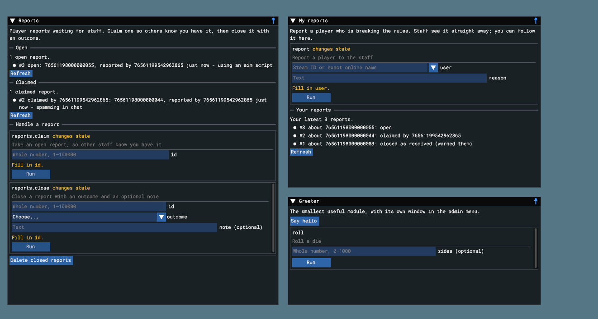

# Reports: a larger example module

[ReportsModule.cs](ReportsModule.cs) lets players report other players and
staff handle the reports. It is the step up from the [greeter](../greeter/README.md):
several permissions, commands with several kinds of arguments, four documentation
pages and two windows in the admin menu.



## Using it

1. Drag the `reports` folder into your game's `Code/Superuser/Modules` folder.
2. Enter Play, or restart it. The module loads itself.
3. Grant the permissions, for example:

   ```text
   admin group player permission allow example.reports.file
   admin group moderator permission allow example.reports.read
   admin group moderator permission allow example.reports.handle
   admin group admin permission allow example.reports.manage
   ```

4. Players run `admin report <user> <reason>` or use **Modules › My reports**;
   staff use **Modules › Reports**.

## Commands

| Command | Arguments | Permission |
|---|---|---|
| `report` | `<user> <reason...>`: a player, then free text | `example.reports.file` |
| `reports mine` | none | `example.reports.file` |
| `reports list` | `[status] [page]`: open, claimed, closed or all; a page number | `example.reports.read` |
| `reports claim` | `<id>`: a whole number | `example.reports.handle` |
| `reports close` | `<id> <outcome> [note...]`: a number, resolved/rejected/duplicate, free text | `example.reports.handle` |
| `reports clear` | `<closed\|all>` | `example.reports.manage` |

The host checks every argument before the module sees it: `reports close 3 maybe`
is refused because `maybe` is not an outcome, and `reports claim 0` because ids
start at 1.

## What to look at

**One command, several argument kinds.** `reports close` takes a number, a
choice and optional free text that runs to the end of the line:

```csharp
registration.RegisterCommand( Command( "reports.close", "Close a report with an outcome and an optional note", HandlePermission,
	CommandExecutionPolicy.Mutation, Id(),
	new CommandArgumentDescriptor( "outcome", "resolved, rejected or duplicate", CommandArgumentKind.Enum, choices: Outcomes,
		audit: CommandArgumentAudit.SafeValue ),
	new CommandArgumentDescriptor( "note", "What you did, for the record", CommandArgumentKind.String, isOptional: true, isRemainder: true ) ),
	( context, arguments ) => Task.FromResult( Close( context, arguments ) ) );
```

In the admin menu that becomes a number field, a dropdown and a text box.

**Windows in the admin menu.** `AddMenuWindow` describes a window from headings,
text, live command replies, command forms and buttons:

```csharp
registration.AddMenuWindow( "Reports", window => window
	.Text( "Player reports waiting for staff. Claim one so others know you have it, then close it with an outcome." )
	.Heading( "Open" )
	.Live( "reports.list", "open" )
	.Heading( "Claimed" )
	.Live( "reports.list", "claimed" )
	.Heading( "Handle a report" )
	.CommandForm( "reports.claim" )
	.CommandForm( "reports.close" )
	.Separator()
	.Button( "Delete closed reports", "reports.clear", "closed" ) );
```

Everything in a window runs one of the module's commands, so permission checks,
confirmations and the audit log all apply. Each viewer only sees what they may
use: a player with `example.reports.file` gets **My reports** but not
**Reports**. Live lists refresh every few seconds while the window is open.

**Several permissions.** Filing, reading, handling and deleting are separate
keys, so each group gets exactly what it needs. The "Setting up" documentation
page suggests a split.

**Documentation that reads like a manual.** Four pages, in the order an admin
needs them: an overview with the flow and a command table, a page for players, a
page for staff with an outcomes table, and a setup page with the console
commands. They appear in **Superuser › Documentation**.

**State in memory.** Reports are kept in a list and cleared when the module
stops, to keep the example short. A real module would keep them in the store
from `Superuser.GetStore()` so they survive a restart.

## How it is checked

Contract tests load this exact file through the automatic loader and run the
whole flow (file, list, claim, close, mine, clear) through the real dispatcher,
including each permission and the argument checks, and confirm which menu windows
an owner and a player receive. It was also loaded in a game in the s&box editor:
the commands answered and the windows above showed the live reports.
