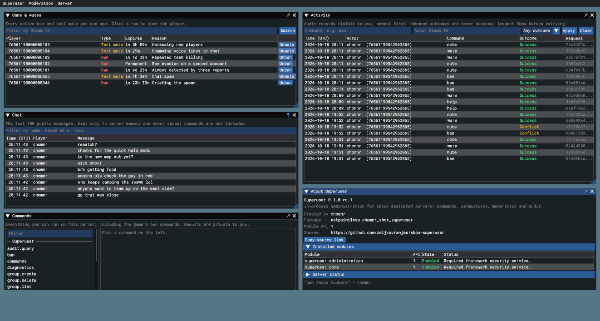

<p align="center">
  
</p>

# Superuser — administration for s&box dedicated servers

This library gives an s&box game a complete administration layer: commands,
permissions, moderation, audit and storage, all running inside the game's own
dedicated server process. Players reach it through the console, through slash
commands in chat, or through an optional in-game moderation menu. Your game
reaches it through one C# facade, `Superuser`.



Every request carries the engine's own idea of who sent it. The host decides
what that player may do, records the attempt before acting, runs the command and
replies privately to the sender. Nothing about a player's authority is taken from
the message itself, and nothing a client sends can widen what it is allowed to
do.

Superuser does not know what a "player" means in your game. Commands that change
gameplay — heal a pawn, refill a colonist, teleport someone — come from your
code, registered as modules with their own permission keys. The library supplies
the routing, authorization, audit trail and storage around them.

## Example

A command is a method that returns a result. Superuser checks the caller's
permission before it runs and sends the reply only to the caller.

```csharp
[AdminCommand( Name = "ping", Description = "Reply with Pong!", Permission = "example.ping",
	ModuleId = "example.ping", ExecutionPolicy = CommandExecutionPolicy.ReadOnly )]
public static CommandResult Ping( CommandContext context )
{
	return new CommandResult( CommandStatus.Success, "Pong!" );
}
```

Register its module once the bootstrap is ready, grant `example.ping` to whoever
should use it, and players can run `/admin ping` in chat or `admin ping` in the
console. The ***[Tutorial](tutorial.md)*** walks through exactly that, from an
empty scene to a working command.

## Contents

- ***[Core concepts](concepts.md)*** &mdash; the handful of ideas everything else
  builds on.

- ***[Tutorial](tutorial.md)*** &mdash; install the library, configure an owner,
  add your first command.

- ***[Where Superuser fits](context.md)*** &mdash; what it is designed for, and
  what it deliberately leaves out.

- ***[Running Superuser](running.md)*** &mdash; editor testing, dedicated
  servers, and what to check when something fails.
    - [In the editor](running/editor.md)
    - [On a dedicated server](running/dedicated.md)
    - [When something fails](running/troubleshooting.md)

- ***[Reference: the host API](reference.md)*** &mdash; what your game's code
  calls.
    - [The Superuser facade](reference/facade.md)
    - [Commands](reference/commands.md)
    - [Modules](reference/modules.md)
    - [Permissions](reference/permissions.md)
    - [Chat](reference/chat.md)
    - [Native settings](reference/settings.md)
    - [Custom storage](reference/storage.md)
    - [Storage and recovery](reference/recovery.md)

- ***[Reference: console commands](console.md)*** &mdash; every built-in
  command and its permission.

- ***[Reference: the admin menu](menu.md)*** &mdash; each window, and how to
  replace the menu with your own interface.
    - [Layout, pins and pop-ups](menu/layout.md)
    - [Players](menu/players.md)
    - [Bans & mutes](menu/bans.md)
    - [Chat](menu/chat.md)
    - [Commands](menu/commands.md)
    - [Activity](menu/activity.md)
    - [Permissions](menu/permissions.md)
    - [Replacing the menu](menu/replace.md)

- ***[Verification](validation.md)*** &mdash; how the library was tested and
  what was measured.

- ***[Release status](release.md)*** &mdash; what this source candidate is, and
  what is not yet certified.

The [game samples](../dev/samples/README.md) show two complete integrations, and
the [changelog](../CHANGELOG.md) lists every change.
